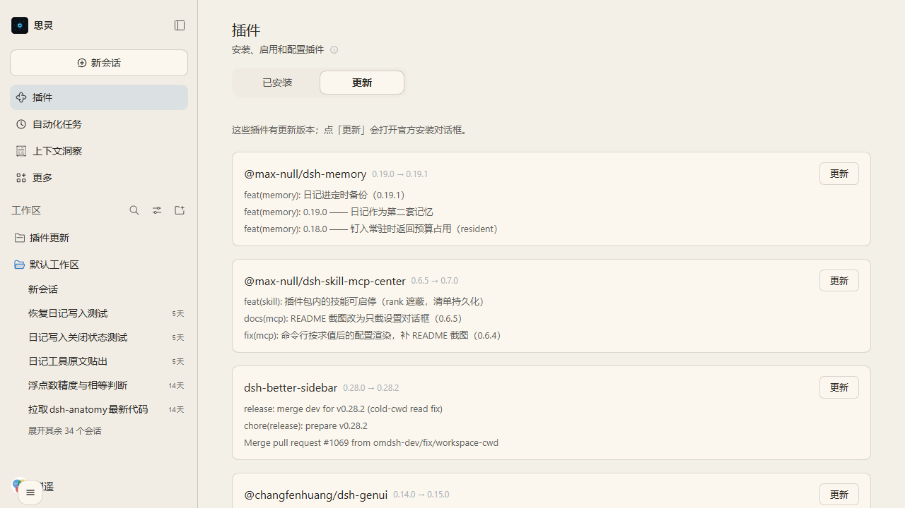

# dsh-plugin-center

This plugin belongs to the **`@max-null/*` family** — a set of plugins that together form the **[SSID (思灵 · Seek Soul in Darkness)](https://github.com/Max-Null/seek-soul-in-darkness)** desktop experience. SSID is the box that bundles them all: `dsh-capture` · `dsh-chat-rail` · `dsh-chinese-thinking` · `dsh-draft-polish` · `dsh-guardian` · `dsh-habit` · `dsh-memory` · `dsh-node-appearance` · `dsh-plugin-center` · `dsh-quick-toolbar` · `dsh-skill-mcp-center` · `dsh-ssid-panels` · `dsh-ssid-zh-ui` · `dsh-achievements` · `dsh-allostasis` · `dsh-skills` · `dsh-ssid-env` · `dsh-ssid-pwsh-retry` · `dsh-tone-layer`.

本插件属于 **`@max-null/*` 插件系列**——这一系列共同构成 **[SSID（思灵 · Seek Soul in Darkness）](https://github.com/Max-Null/seek-soul-in-darkness)** 桌面体验。SSID 是整合它们的盒：`dsh-capture` · `dsh-chat-rail` · `dsh-chinese-thinking` · `dsh-draft-polish` · `dsh-guardian` · `dsh-habit` · `dsh-memory` · `dsh-node-appearance` · `dsh-plugin-center` · `dsh-quick-toolbar` · `dsh-skill-mcp-center` · `dsh-ssid-panels` · `dsh-ssid-zh-ui` · `dsh-achievements` · `dsh-allostasis` · `dsh-skills` · `dsh-ssid-env` · `dsh-ssid-pwsh-retry` · `dsh-tone-layer`。

Update checker for [DeepSeek Harness](https://github.com/deepseek-ai/deepseek-harness) (`dsh`) — adds an **Updates** tab to the built-in Plugins page.

给 DSH 内置的「插件」页加一个**更新** tab：列出已安装插件的上游新版本，一键交给官方安装流程执行。

自 0.5.0 起不再自带市场、安装、启停与诊断面板——那些官方已经有了（`plugin-manager` + `plugin-market`，后者通过「索引源」提供可安装清单）。本插件只保留官方唯一没有的那件事：**更新检测**。

## Features / 功能

- **Updates tab / 更新 tab** — 内置「插件」页的第三个 tab（排在「已安装 / 发现」之后），列出每个有上游新版本的已安装插件、它的 changelog 行，以及逐行一个**更新**按钮。
- **Official install path / 走官方安装** — 按钮把精确的 `name@version` 交给页面自己的安装对话框（`plugin_manager.installBundle`），构建批准、失败回滚、bundle 校验都留在官方那条链上；本插件不再自己调 pnpm。
- **DSH compatibility / 兼容性** — peer 范围与当前内核不符的条目标记号并禁用按钮，不让人点进一次注定失败的安装。
- **LLM update RPC / LLM 更新端点** — `llm-update.prepare` / `.log` / `.result` 仍留在 host 侧供 agent 流程使用；它们的 Web UI 随旧面板一起下线。
- **Skin-compatible / 皮肤兼容** — 每个颜色都用 `var(--dsw-*)` token，皮肤插件同样能改这套 UI。
- **Packaged upgrade skill / 自带升级技能** — `dsh-plugin-upgrade` 技能随包内置（`SkillProvider`，rank 550），干净机器上 LLM 更新流程也能直接加载。

## Screenshots / 截图

装完后没有独立入口——它长在内置「插件」页里，作为第三个 tab。

**入口 / Entry：** 侧栏「插件」→「更新」tab

| 更新 / Updates |
| :---: |
|  |

## Install / 安装

A `dsh` installation keeps one profile per surface, and **a plugin is visible only in the profile it was installed into**. Installing into the wrong one is the usual reason an install looks like it did nothing.

`dsh` 的每种使用形态各有一个 profile，**插件装进哪个 profile，就只有那个 profile 看得见它**——「装完没反应」通常就是这个原因。

| DSH | Profile | Command |
| :--- | :--- | :--- |
| `dsh web` (CLI + browser) | `web` | `dsh plugin --profile web add @max-null/dsh-plugin-center` |
| Official desktop app / 官方桌面应用 | `desktop` | `dsh plugin --profile desktop add @max-null/dsh-plugin-center` |

From the GitHub source, replace the package name with `github:Max-Null/dsh-plugin-center`。从 GitHub 源码安装时把包名换成 `github:Max-Null/dsh-plugin-center`。

Restart DSH, then open **插件** in the sidebar and switch to the **更新 / Updates** tab. 重启 DSH 后打开侧栏「插件」，切到「更新」tab。

Requirements / 前置条件：DSH runtime within `>=0.1.1-rc.1 <0.3.0` (the `@deepseek-ai/dsh-*` peer range). A runtime outside it makes DSH skip this bundle **silently** — no error, no entry. 内核须落在 `>=0.1.1-rc.1 <0.3.0` 内；范围外 DSH 会**静默跳过**这个 bundle，不报错也不出现条目。

### Uninstall / 卸载

```sh
dsh plugin --profile <your profile> remove @max-null/dsh-plugin-center
```

### The built-in Plugins page / 官方自带的「插件」页

If the sidebar **Plugins** page shows *本部署没有可管理的 profile，无法安装或启停插件。*, that message is the DSH kernel's own and does not come from this plugin. DSH renders it whenever the host has no `pluginManager` service (`packages/boot/plugin-inventory/src/index.ts`), and that service is gated in `packages/bundle/base/cordis.patch.yml` by a single `disabled: !!js "!ctx.get('profileContext')"` row. This plugin contributes one **Updates** tab to that page and nothing else; it neither provides nor affects `pluginManager`.

侧栏「插件」页出现 *本部署没有可管理的 profile* 时，那句话来自 DSH 内核，不是本插件。DSH 在宿主没有 `pluginManager` 服务时就会显示它，而该服务在 `packages/bundle/base/cordis.patch.yml` 里只由一行 `disabled: !!js "!ctx.get('profileContext')"` 决定。本插件只往那一页贡献一个**更新** tab，既不提供也不影响 `pluginManager`。

Two checks / 两条自查：

1. Remove this plugin, restart, and reopen the page. **If the message is still there, this plugin was never the cause.** 卸掉本插件、重启，再看那一页——若那句话仍在，就与它无关。
2. Look in `~/.dsh/profiles/<your profile>/cordis.patch.yml` for a row that switches the manager off, and delete that row:

   ```yaml
   - id: plugin-manager
     disabled: true
   ```

   在 `~/.dsh/profiles/<你的 profile>/cordis.patch.yml` 里找有没有把管理器关掉的条目（形如上），删掉它即可恢复官方插件页。

## Development / 开发

```sh
pnpm install
pnpm build   # tsc (host) + esbuild (browser bundle)
```

## License / 许可

[MIT](./LICENSE)
